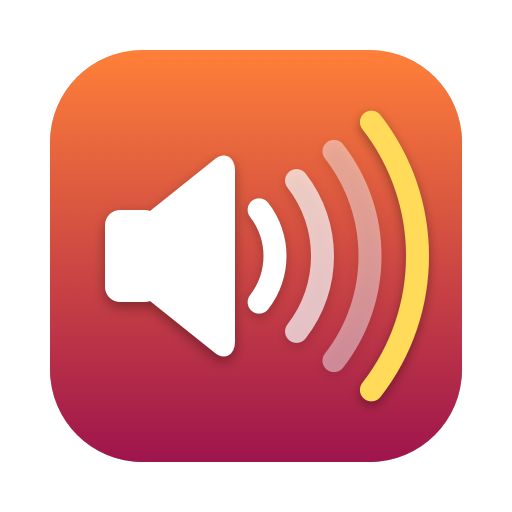

<p align="center"></p>

# Louder

**Turn your Mac up past 100%.**

Some videos, calls and podcasts are too quiet even at full volume, and laptop speakers top out
early. Louder sits in the menu bar and boosts what your Mac plays, up to 400% (+12 dB). It can
boost everything, or only the apps you pick. A limiter catches the loud parts, so turning it up
makes things louder without crackling or distortion.

It works with whatever you're listening on (built-in speakers, AirPods, a USB DAC) and follows
you when you switch. There's no audio driver or system extension to install. Quit Louder and
your Mac sounds exactly as it did before.

## Using it

Click the speaker-with-a-plus icon in the menu bar for the switch, the level slider, the app
list and the current output device.

| Action | What it does |
| --- | --- |
| ⌥-click the menu bar icon | Turn the boost on/off |
| ⌃⌥⌘L | Turn the boost on/off from anywhere |
| ⌃⌥⌘↑ / ⌃⌥⌘↓ | Step the level up/down; the new level flashes next to the icon |

The slider moves in even steps of loudness, so 100→200% feels like the same jump as 200→400%.
The readout shows the level as a percentage.

### Choosing apps

By default every app is boosted. Tick one or more apps in the menu to boost only those; the
menu stays open while you pick, and everything else plays at normal volume. A browser counts as
one app, including its helper processes (Chrome's tabs, Safari's web content). Pick **All Apps**
to go back to boosting everything.

### Menu bar options

- **Launch at Login**
- **Sound Settings…**

## Requirements

- macOS 27 or later
- Swift 6.3 or later, from Xcode or the Command Line Tools (`xcode-select --install`)

## Install

There is no prebuilt download; both ways below build it from source on your Mac.

### Homebrew

```sh
brew install alxrxs/tap/louder
ln -sfn "$(brew --prefix)/opt/louder/Louder.app" /Applications/Louder.app
open /Applications/Louder.app
```

Homebrew signs it ad-hoc, so after each `brew upgrade` remove Louder from the System Audio
Recording list and grant it again.

### From source

```sh
git clone https://github.com/alxrxs/louder.git
cd louder
./build.sh install
```

This builds a release copy, puts it at `/Applications/Louder.app` and launches it. The first time
you turn the boost on, macOS asks for **System Audio Recording** permission; Louder needs it to
hear what apps are playing. If you deny it, the menu says so and links to System Settings →
Privacy & Security, where you can turn it on later.

`./build.sh` on its own only builds `build/Louder.app`.

**Signing:** `build.sh` signs with your first *Apple Development* certificate if you have one (a
free Apple ID in Xcode is enough), or `CODESIGN_IDENTITY` if you set it. Without one it falls
back to an ad-hoc signature, which works, but macOS treats every rebuild as a new app and you
have to grant System Audio Recording again each time.

### Uninstall

Quit Louder from its menu, delete `/Applications/Louder.app` (and `brew uninstall louder` if you
used Homebrew), and remove it from the System Audio Recording list in System Settings.

## Caveats

- **If Louder quits or crashes, sound goes straight back to normal.** The boost only exists while
  Louder is running; nothing is left behind in your audio setup.
- **Boosted audio passes through Louder**, adding a couple of milliseconds of delay. That's
  inaudible for music and video, and fine for calls.
- **Private APIs.** macOS has no public way to check the System Audio Recording permission before
  using it, or to tell which app a helper process (like a browser tab) belongs to, so Louder uses
  undocumented system calls for these. A macOS update can break them. Each one is looked up at
  runtime, so a missing one degrades that feature instead of crashing.
- **Boosting can't add detail that isn't there.** A very quiet recording gets louder, but so
  does its background hiss.

## Development

```sh
swift build        # debug build
swift test         # unit tests (LouderCore: limiter, gain, level steps, app selection, watchdog)
./build.sh install # build, install to /Applications and relaunch
```

`Sources/LouderCore` holds the pure, tested logic; `Sources/Louder` is the app (the audio engine,
the menu, permissions and hotkeys). The icon is drawn by `scripts/make-icon.swift`.

### How it works

Louder creates a Core Audio process tap on the apps being boosted, which captures their audio and
mutes the original. A private aggregate device pairs that tap with your output device; its IO
callback runs the audio through:

- a gain ramp, so moving the slider doesn't click;
- a look-ahead peak limiter: −1 dBFS ceiling, channels linked so the stereo image doesn't shift,
  1.5 ms look-ahead, 100 ms release;
- the output's channel layout.

The audio path is real-time safe (no allocation, locks or reference counting). When nothing needs
limiting it costs one vectorised peak scan and a memory copy: about 1.3 µs per 512-frame stereo
buffer on Apple silicon, and about 4.7 µs while limiting hard, under 0.05% of the time available.

The engine rebuilds itself when the output device, its sample rate or channel layout changes, and
after sleep. A watchdog restarts it if audio stops flowing, and the menu says so if that keeps
failing.

Releases are tagged `vX.Y.Z`; `build.sh` stamps the latest tag into the app's version and the
commit count into its build number.

## License

[GPL-3.0](LICENSE). Copyright © 2026 Andrei.
